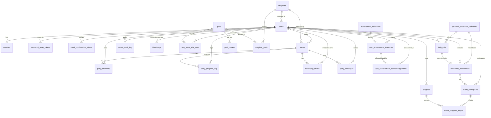

# Data Models (D1 SQLite)

> Last updated: 2026-11-05 · Migrations: 0001–0159 · Full DDL: `migrations/`

## Tables

| Table | Purpose | Key Migration |
|---|---|---|
| `users` | Credentials, profile flags, avatar, friend code | 0006, 0008 |
| `sessions` | Active user sessions (token-based) | 0008 |
| `progress` | Daily walking logs (one entry per user per date) | 0002 |
| `goals` | Reusable milestone content (title, description, image, default distance compatibility) | 0003 |
| `goal_content` | Ordered Markdown lore entries attached to canonical goals | 0140 |
| `content_discovery_events` | Append-only best-effort analytics for goal-content teasers and opens | 0141 |
| `storylines` | Named journey routes users and fellowships can select | 0132 |
| `storyline_goals` | Per-storyline goal ordering and distances | 0132 |
| `password_reset_tokens` | Temporary tokens for password reset flow | 0010 |
| `email_confirmation_tokens` | Email verification tokens (24h expiry, 3 resends/hr) | 0008 |
| `parties` | Fellowship groups with configurable distance modes | 0020+ |
| `party_members` | User–party membership with join/departure tracking | 0020+ |
| `party_progress_log` | Audit trail / activity feed for party walks | 0020+ |
| `admin_audit_log` | Append-only admin action log (never deleted) | 0020+ |
| `friendships` | Mutual friend relationships (pending → accepted) | 0020+ |
| `fellowship_invites` | Friend-based party invitations | 0020+ |
| `party_messages` | Fellowship chat messages for unified activity feed | 0124 |
| `push_subscriptions` | Per-device browser push subscriptions for authenticated users | 0126 |
| `one_more_mile_sent` | Tracks which "One More Mile" nudge notifications have been sent per user per goal | 0128 |
| `milestone_journals` | Plain-text journal entries (one per user per canonical goal), shared across storylines | 0139 |
| `achievement_definitions` | Shared reusable badge metadata (slug, name, image, type, repeatability) registered by any feature | 0142 |
| `user_achievement_instances` | Append-only earned-badge records with idempotency keys, shared across features | 0143 |
| `user_achievement_acknowledgements` | Per-user acknowledgement projection over earned instances (pending = instances minus acks) | 0147 |
| `personal_encounter_definitions` | Reusable personal challenge config (copy, artwork keys, duration, target strategy) | 0152 |
| `encounter_occurrences` | Per-user accepted challenge instance (target, coverage window, grace deadline, status) | 0153 |
| `daily_rolls` | One personal encounter roll per user per UTC day (offer, preview target, status) | 0154 |
| `event_participants` | Participant row per occurrence with cached credited distance | 0155 |
| `event_progress_ledger` | Idempotent credit rows linking walk progress to a participant | 0156 |

## Key Constraints & Invariants

These are rules the schema enforces or that the application layer must uphold — not discoverable from DDL alone.

### users
- `is_admin` toggled via admin UI (`PUT /api/admin/users/:id/admin`). Admins cannot revoke their own admin status.
- `avatar_id` must be NULL or a valid slug from `src/avatar-slugs.ts` (validated by `isValidAvatarSlug` on PUT).
- `friend_code`: 8-char cryptographically random; backfill logic in `src/auth-utils.ts`.
- `notifications_enabled` is a global delivery toggle for server-side push sends. It does not revoke browser permissions or delete device subscriptions.
- `one_more_mile_enabled` is a per-user toggle for the "One More Mile" milestone nudge notifications. Defaults to ON (`1`) for new users.
- `inactivity_nudge_enabled` is a per-user toggle for "Gandalf's Absence Arc" re-engagement notifications. Defaults to ON (`1`) for new users.
- `reengage_tier_sent` tracks the highest re-engagement notification tier sent during the current inactivity period (0 = none, 1–4 = tier reached). Resets to 0 when the user logs a new walk.
- `active_storyline_id` selects the user's current journey. If null, inactive, or no longer visible to the user, handlers fall back to the default `frodo-sam` storyline.
- `storyline_distance_offset` is applied to raw progress for display: `max(0, raw_distance + offset)`. Switching with carry preserves displayed distance; switching with reset stores `-raw_distance`.

### storylines / storyline_goals
- `storylines.slug` is unique and uses lowercase hyphenated slugs. The default seeded storyline is `frodo-sam` with `path_key = 'fellowship'`.
- `storylines.admin_only = 1` keeps an active storyline visible to admins only while it is being built. Public list/switch handlers exclude admin-only storylines for regular users.
- `path_key` lets future storylines select a map path dataset. Unknown client path keys must fall back to the fellowship path until a new path is registered.
- `storyline_goals` reuses rows from `goals` and stores the storyline-specific `distance` and `sort_order`. This allows the same goal content to appear in multiple routes at different distances.
- Existing goals are backfilled into `storyline_goals` for `frodo-sam`, preserving current behavior for existing users.

### goal_content
- Added in migration `0140`.
- Columns: `id` primary key, `goal_id` foreign key to `goals(id)` with `ON DELETE CASCADE`, `type` text, `title` text, `body` text, `author_attribution` text, `sort_order` integer, `created_at`, and `updated_at`.
- `type` has a `CHECK` constraint allowing only `story`, `poetry`, or `appendix`.
- `body` stores Markdown; clients render it as sanitized HTML.
- `author_attribution` is nullable.
- `sort_order` has a `CHECK` constraint for the range `0`–`999`.
- `UNIQUE(goal_id, sort_order)` enforces one ordered content stream per goal.
- Index: `idx_goal_content_goal_id(goal_id, sort_order)`.
- Application validation limits: `title` ≤ 120 characters, `author_attribution` ≤ 255 characters, `body` ≤ 20,000 characters, and `sort_order` from `0` to `999`.

### content_discovery_events
- Added in migration `0141`.
- Append-only analytics table for goal-content teaser impressions and content opens.
- Columns: `id` primary key, nullable `user_id`, nullable `party_id`, `goal_id`, nullable `content_id`, `event_type`, `context_type`, and `created_at`.
- `event_type` has a `CHECK` constraint allowing only `teaser_impression` or `content_open`.
- `context_type` has a `CHECK` constraint allowing only `personal` or `fellowship`.
- The table intentionally has no foreign keys. Discovery analytics are best-effort and must not fail user-facing flows if related rows are deleted or event writes are dropped.
- Indexes exist on `goal_id` and `created_at`.

### push_subscriptions
- Stores one row per browser/device subscription endpoint. Multiple rows per user are expected.
- `endpoint` is globally unique. Application logic rejects an endpoint if it is already attached to a different user.
- `last_used_at` is updated when the app refreshes or successfully uses a subscription, and stale endpoints are deleted on HTTP `404`/`410` push responses.

### one_more_mile_sent
- `UNIQUE(user_id, goal_id)` prevents the same nudge from being sent more than once per user per goal.
- `storyline_goal_id` supports storyline-specific nudges. New code should prefer the partial unique index `(user_id, storyline_goal_id) WHERE storyline_goal_id IS NOT NULL`.
- Rows are kept when at least one push delivery succeeds or when a stale subscription is cleaned up after an HTTP `404`/`410`; otherwise the operation is rolled back so the nudge can be retried later.
- Foreign keys cascade on user/goal deletion.

### milestone_journals
- `UNIQUE(user_id, goal_id)` ensures at most one plain-text journal entry per user per canonical goal.
- Journal identity is canonical `goal_id`, not `storyline_goal_id` — the same entry is shared across all storylines that reuse that goal.
- `body` is plain text only, trimmed and validated as non-empty with a 2000-character maximum at the API layer.
- Timestamps: `created_at` on insert, `updated_at` on subsequent updates.
- Indexes: `idx_milestone_journals_goal_id` (fast goal-scoped reads) and `idx_milestone_journals_user_id_goal_id` (covering index for dominant lookup pattern).
- Foreign keys cascade on user/goal deletion.

### achievement_definitions
- Added in migration `0142`. Shared across all consuming features — no feature creates its own badge-definition table.
- `slug` is unique (indexed) and human-readable (e.g. `nazgul-outrun`, `book-fellowship-1-complete`). Consuming features reference definitions by slug when calling `awardAchievement`. Recommended slug prefix convention per feature (`book-*`, `challenge-*`, `field-guide-*`) to avoid collisions.
- `badge_type` is a free-form string defined by consuming features (no enum/CHECK constraint at the schema layer).
- `is_repeatable` (`0`/`1`) is enforced by the domain service, not just documentation: `awardAchievement` blocks a second award of a non-repeatable badge regardless of idempotency key.
- `metadata` is a nullable TEXT column for JSON about the definition itself (not the earned instance). Every key is optional and display/award-facing only:

  | Key | Type | Meaning |
  |---|---|---|
  | `storyline` | string or `null` | Storyline slug the badge is scoped to; absent or `null` means global |
  | `rank` | 1–4 | Fixed rank for non-repeatable definitions |
  | `rank_thresholds` | `[number, number, number, number]` | Four strictly ascending `earned_count` values mapping to ranks 1–4 |
  | `collection` | `{ slug, label, index, size }` | Numbered position in an ordered set; absent for standalone badges |
  | `threshold_km` | number | Displayed storyline distance that awards a `journey` badge |
  | `criteria` | string | Descriptive condition label for authors, e.g. `first_walk`, `seven_day_streak`, or `trailing_7d_km >= 100`; not evaluated by SQL and not dispatched by a generic hook |
  | `unit` | string | Display plural for repeatable progress, e.g. `weeks` |

- Display metadata is optional and parsed defensively by `src/badge-presentation.ts`. Null metadata, invalid JSON, wrong types, and out-of-range values are all treated as absent: the API falls back to rank 1, no collection, and a null storyline. A bad definition can never break the achievements endpoint.
- Rank labels: 1 = `bronze`, 2 = `silver`, 3 = `gold`, 4 = `mithril`.
- Rank resolution: a fixed `rank` always wins. `rank_thresholds` select the rank for repeatable badges only when `rank` is absent — `earned_count >= rank_thresholds[i]` selects rank `i + 1`, so exact boundaries count; below the first threshold stays rank 1 and above the last stays rank 4.
- `getUserAchievementSummary` selects `ad.metadata` and returns it on each `AchievementSummary` so the API layer can resolve `presentation`. The raw string is never serialized to clients.
- Catalog expansion (`0145`) adds three global habit definitions and a two-badge community fellowship collection using the same `criteria` and `unit` conventions. These are descriptive labels, not a query language; awarding is keyed on `badge_type` plus the consuming feature's slug/criteria logic.
- Migration `0146` only corrects the seeded Faithful Walker description to the calendar-week rule; it makes no schema change.
- This change is data-layer-only: no admin UI manages these rows. Each consuming feature manages its own definitions (via migration seed data or its own admin surface).

### user_achievement_instances
- Added in migration `0143`. Append-only: rows are **never updated or deleted** by application code, even on walk edits, walk deletes, or progress reconciliation. This is the single source of truth for both idempotency and repeat counts.
- `UNIQUE(user_id, achievement_id, idempotency_key)` is the idempotency mechanism. Consuming features must supply a domain-meaningful key (e.g. `book_attempt:<attempt_id>`, `encounter_occurrence:<occurrence_id>`) — the same logical award event must always produce the same key so retries are safe no-ops. This caller-supplied key is stored as-is only for **repeatable** badges.
- For **non-repeatable** definitions, `src/achievement-utils.ts`'s `awardAchievement` ignores the caller-supplied idempotency key for storage purposes and writes a fixed sentinel (`NON_REPEATABLE_IDEMPOTENCY_KEY`) instead. This makes the single `UNIQUE(user_id, achievement_id, idempotency_key)` constraint behave as `UNIQUE(user_id, achievement_id)` for those rows, so the database itself — not just the pre-insert lookup — rejects a second award even when two concurrent requests race each other using different caller-supplied keys.
- Repeat counts (`earned_count` in `AchievementSummary`) are always derived via `COUNT(*) GROUP BY achievement_id` in `getUserAchievementSummary` — there is no mutable counter column, so counts can never drift from the underlying rows.
- `context_metadata` is a nullable TEXT column for per-occurrence JSON context (e.g. storyline name, book title, distance at award time). It is read-only display/audit data; only `user_id`, `achievement_id`, and `earned_at` are indexed for querying.
- `achievement_id` has no `ON DELETE CASCADE` — removing a definition (not currently supported by any UI) would orphan instances. Definitions should be soft-deleted or archived rather than hard-deleted if this becomes necessary later.
- The table is shared infrastructure; API routes and UI live in the consuming features. `src/achievement-utils.ts` exposes `awardAchievement`, `getUserAchievements`, and `getUserAchievementSummary` as a plain TypeScript module (following the `-utils.ts` convention of `auth-utils.ts`, `storyline-utils.ts`); consuming features call these directly.

### user_achievement_acknowledgements
- Added in migration `0147`. A projection, not a log: one row per user per earned instance, enforced by `PRIMARY KEY (user_id, instance_id)`.
- Pending awards = the caller's `user_achievement_instances` rows anti-joined against this table. No row means pending, so every earned-but-never-seen instance (including history predating the table) is pending with no backfill needed.
- Inserts are per-ID `INSERT ... SELECT ... ON CONFLICT DO NOTHING` scoped to instances the caller owns, capped at 100 IDs per request and executed as one atomic D1 batch. Re-acknowledging, duplicate IDs in one request, foreign IDs, and stale IDs are silent no-ops; only newly inserted rows count toward `{ acknowledged: n }`.
- Acknowledgement never creates, updates, or deletes `user_achievement_instances` rows — the append-only guarantee is untouched. Earned instances remain the single source of truth for counts.
- `acknowledged_at` records when the acknowledgement was written. It is not a cursor and is not used for pending ordering (that is `earned_at ASC, id ASC`).
- The composite primary key's `user_id` prefix serves the pending anti-join, so no secondary index is created.
- Both foreign keys cascade: acknowledgements are meaningless without their user or earned instance.

### personal challenges (0152–0159)
- Five tables form one engine: reusable definitions, per-user occurrences, per-day rolls, participants, and a progress ledger. They are deliberately separate from any future community campaign schema.
- `personal_encounter_definitions`: `slug` is unique. Stores `name`, `description`, `image_slug`, `badge_slug`, `duration_days`, `target_stretch_multiplier`, `target_min_distance`, `target_max_distance`, `is_repeatable`, `enabled`, and timestamps. Definitions are soft-disabled via `enabled`, never hard-deleted; `encounter_occurrences.definition_id` does **not** cascade.
- `encounter_occurrences`: one row per acceptance, linked to `definition_id` (no cascade) and `daily_roll_id` (cascades, `UNIQUE` — one daily roll produces at most one occurrence, so a repeated accept returns the existing row). `user_id` cascades. `status` is `active` / `completed` / `failed`; stores `personalized_target`, `started_at`, `coverage_end_date`, `grace_deadline`, `completed_at`, and timestamps. Indexes: `(user_id, status)` for user-scoped lookups and `(status, grace_deadline)` for settlement.
- `daily_rolls`: `user_id` cascades. `roll_date` is a UTC date; `encounter_definition_id` and `preview_target_distance` are nullable (null = no offer). `status` is `offered` / `accepted` / `declined`. `UNIQUE(user_id, roll_date)` makes the roll idempotent — repeated calls return the stored row including its status. Index on `roll_date`.
- `event_participants`: `occurrence_id` and `user_id` cascade. `progress_distance` is a **cached** total recomputed from the ledger, never the source of truth; `joined_at` is the acceptance timestamp. `UNIQUE(user_id, occurrence_id)`; index on `user_id`.
- `event_progress_ledger`: `participant_id` cascades; `source_progress_id` cascades to `progress`, so deleting a walk removes its credit. `UNIQUE(participant_id, source_progress_id)` makes crediting idempotent. Index on `participant_id`.
- Target is computed once at roll time (`preview_target_distance`) and copied to `personalized_target` at acceptance — the number shown in the modal is always the number the challenge uses.
- Coverage window is `[started_at, coverage_end_date]`; `grace_deadline = coverage_end_date + 3 days`. Only `progress.date` values inside the window count, including walks logged during the grace period.
- Completion is `SUM(ledger.distance) >= personalized_target` — there is no all-coverage-days precondition, so a challenge can complete at acceptance or on any later eligible reconciliation.
- Seeds: definition `nazgul-pursuit` (3 days, 1.3 stretch, 3–50 km clamp) and badge `challenge-nazgul-outrun` (`challenge` type, repeatable, `rank_thresholds` `[1,2,3,5]`, `unit` `pursuits`).

### parties
- `distance_mode` (`incremental` | `cumulative`): set at creation, **immutable**.
- `leave_distance_behavior` (`keep` | `remove`): leader-updatable.
- `dissolved_at` set when all members depart — dissolved parties cannot be rejoined.
- `active_storyline_id` can be set at creation and later changed by the leader. It mirrors the user storyline model for fellowship views. Member contributions remain raw and are not changed by storyline reset.

### party_members
- **Leader invariant:** `role = 'leader'` must match `parties.leader_id`. Leader transfers must update both atomically in a transaction.
- `distance_at_join` captures cumulative distance at join — required for `incremental` mode calculation.
- `distance_kept` and `contribution_at_departure` are frozen at departure to preserve correct progress reads even if `leave_distance_behavior` changes later.
- Re-join reactivates the existing row (no new insert).

### friendships
- `UNIQUE(requester_id, addressee_id)` only prevents one-direction duplicates. **Application layer must check both directions** before inserting (enforced in friend request handler).
- `CHECK(requester_id != addressee_id)` — no self-friending.

### fellowship_invites
- Partial unique index `(party_id, invitee_id) WHERE status = 'pending'` prevents duplicate pending invites while allowing re-invites after rejection.
- `inviter_id` must be an active party member; `invitee_id` must be an accepted friend — enforced at application layer.
- Pending invites invalidated (set to `'rejected'`) on party dissolution.

## Foreign Key Cascade Decisions

| FK | Behavior | Rationale |
|---|---|---|
| `party_*` tables → `parties.id` | CASCADE | Deleting a party removes all related data |
| `parties.leader_id` → `users.id` | CASCADE | Leader deletion cascades to party |
| `goal_content.goal_id` → `goals.id` | CASCADE | Deleting a goal removes its authored lore entries |
| `email_confirmation_tokens.user_id` | CASCADE | Cleanup on user deletion |
| `admin_audit_log.admin_user_id` | **No cascade** | Audit records must survive user deletion |
| `user_achievement_instances.user_id` | CASCADE | Standard cleanup on user deletion |
| `user_achievement_instances.achievement_id` | **No cascade** | Definitions are not expected to be deleted; earned instances must never be silently orphaned by app-level cleanup |
| `user_achievement_acknowledgements.user_id` / `.instance_id` | CASCADE | Acknowledgements are meaningless without the user or the earned instance they acknowledge |
| `encounter_occurrences.definition_id` | **No cascade** | Definitions are soft-disabled via `enabled`, mirroring achievement definitions |
| `encounter_occurrences.user_id`, `daily_rolls.user_id`, `event_participants.user_id` | CASCADE | Standard cleanup on user deletion |
| `encounter_occurrences.daily_roll_id` | CASCADE | An occurrence cannot outlive the roll that created it |
| `event_participants.occurrence_id`, `event_progress_ledger.participant_id` | CASCADE | Challenge data is meaningless without its occurrence/participant |
| `event_progress_ledger.source_progress_id` → `progress.id` | CASCADE | Deleting a walk removes its ledger credit |
| All other user FKs | CASCADE | Standard cleanup |

`content_discovery_events` intentionally has no foreign keys because those rows are best-effort analytics.

## Migration Conventions

- Path: `migrations/NNNN_descriptive_name.sql` (zero-padded 4-digit sequence).
- Each migration is a single DDL or data-manipulation operation.
- Schema changes go in migrations; application logic stays in TypeScript.
- Goal description updates use dedicated migrations (see `0011`–`0019` series).
- Goal content tables are additive migrations: `0140` for `goal_content`, `0141` for `content_discovery_events`.
- Personal challenge tables are additive: `0152`–`0156` create the five tables; `0157`–`0158` seed the Nazgul definition and its `challenge-nazgul-outrun` badge; `0159` repairs legacy prototype tables by dropping and recreating `event_participants` and `event_progress_ledger` with the canonical FKs/columns.
- Deploy: `npx wrangler d1 migrations apply walk-to-mordor-db`.

## Entity Relationship Diagram

